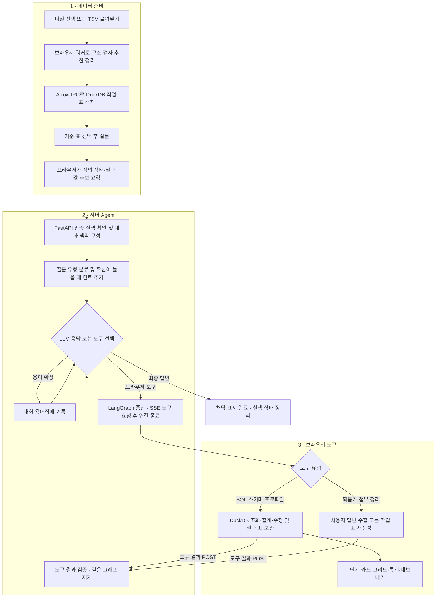

# Browser SQL Agent

**서버에서 Agent를 실행하고, 브라우저에서 DuckDB WASM으로 로컬 CSV를 분석하는 실행 예제입니다.** FastAPI와 LangGraph가 실행 상태를 관리합니다. 서버는 브라우저에 도구 요청을 보내고 스트림을 닫습니다. 브라우저가 SQL을 실행해 집계 결과를 보내면 같은 실행을 이어갑니다.

## 바로 실행하기

Python 3.12 이상과 Node.js 22.12 이상이 필요합니다.

```sh
python -m venv .venv
# PowerShell: .\.venv\Scripts\Activate.ps1
# macOS/Linux: source .venv/bin/activate
python -m pip install -r requirements.txt
npm ci
npm run build
python -m uvicorn server:app
```

[localhost:8000](http://127.0.0.1:8000/)을 열고 **카테고리별 매출 → 분석 실행**을 누르세요. 키 없이 합성 데이터에서 커피 175, 차 125, 베이커리 60을 확인할 수 있습니다. 데모 모드는 질문의 키워드로 카테고리별·지역별·전체 매출 중 하나를 고릅니다.

## 공개 예제의 동작

| 순서 | 처리 |
| --- | --- |
| 1. 질문 | 브라우저가 `POST /api/runs`로 질문을 보냅니다. |
| 2. 중단 | 서버가 집계 기준을 고른 뒤 LangGraph의 `interrupt()`를 호출합니다. `tool_request`를 SSE로 보내고 응답을 닫습니다. |
| 3. 실행 | 브라우저가 정해진 SQL 템플릿을 선택해 DuckDB WASM에서 실행합니다. |
| 4. 재개 | 브라우저가 `POST /api/runs/{run_id}/tool-result`로 결과를 보내면 서버가 `Command(resume=...)`으로 같은 실행을 재개하고 최종 답변을 보냅니다. |

화면의 **실행 흐름과 전송 내용**에서 실제 요청·응답과 브라우저에서 실행한 SQL을 확인할 수 있습니다. 공개 예제는 SSE 응답당 이벤트 한 건을 보내며 답변 토큰 스트리밍은 포털 활용 사례에 해당합니다. [서버 코드](server.py) · [브라우저 흐름](web/main.ts) · [DuckDB 실행기](web/duck.ts)

## 활용 사례 · 포털 데이터 분석

이 패턴을 포털에서는 엑셀·CSV 파일이나 붙여넣은 TSV를 정리하고, 작업 표에 대해 자연어로 질문하는 데 쓰고 있습니다. 아래는 **포털에서의 전체 흐름**입니다. 공개 저장소는 이 중 브라우저 SQL 실행과 서버 중단·재개를 합성 CSV로 재현합니다.



## Duck-UI와의 차이

[Duck-UI](https://github.com/caioricciuti/duck-ui)와 이 예제는 브라우저에서 DuckDB WASM으로 SQL을 실행한다는 점이 같습니다. Duck-UI는 SQL 편집기, 노트북, 차트, 자연어 SQL 생성을 제공하는 분석 작업대입니다. 이 예제는 **서버 Agent가 브라우저에 SQL 실행을 위임하고, 결과를 받아 같은 실행을 재개하는 방법**에 초점을 맞춥니다.

| | Duck-UI | Browser SQL Agent |
| --- | --- | --- |
| 사용 목적 | 브라우저에서 데이터를 탐색하는 SQL 작업대 | 다른 앱에 브라우저 SQL 도구를 붙이는 참조 구현 |
| AI 흐름 | 브라우저의 분석 작업대에서 WebLLM 또는 외부 모델로 SQL 생성 등을 지원 | FastAPI·LangGraph가 실행을 관리하고, 브라우저 도구 결과가 오면 재개 |
| 결과 공유 | 외부 모델의 결과 설명 기능은 사용자 동의를 거쳐 일부 행을 전달 | 질문과 최대 10개의 집계 행을 Agent 서버로 보내며, 전송 내용을 화면에서 확인 |

## 내 CSV와 모델 사용하기

- CSV는 머리글에 `category`, `region`, `amount` 세 열이 있어야 합니다. 최대 5MB를 지원합니다. 브라우저는 카테고리별·지역별·전체 매출을 고정 SQL 템플릿으로 집계합니다.
- 모델 모드를 사용하려면 서버 프로세스에 `MODEL_NAME`, `MODEL_BASE_URL`, 필요한 경우 `MODEL_API_KEY`를 설정한 뒤 재시작하세요. 함수 호출을 지원하는 OpenAI 호환 `/chat/completions`이 필요합니다. [환경 변수 예시](.env.example)는 설정 참고용이며 자동으로 읽지 않습니다.
- 원본 CSV와 전체 표는 브라우저에 남습니다. 질문과 집계 결과는 서버에 전달되고, 모델 모드에서는 설정한 모델 제공자에도 전달됩니다. 집계 결과에는 그룹 이름이 포함됩니다.
- 예제 서버는 로컬 단일 프로세스용입니다. 대기 중인 실행은 메모리에 두고 5분 후 만료되며, 사용자 인증은 제공하지 않습니다.

관련 문서: [DuckDB WASM](https://duckdb.org/docs/stable/clients/wasm/overview) · [LangGraph 중단·재개](https://docs.langchain.com/oss/python/langgraph/interrupts) · [MIT 라이선스](LICENSE)
